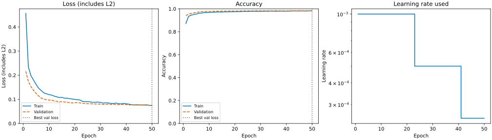

# MNIST CNN

基于 TensorFlow/Keras 的 MNIST 手写数字分类项目，用于学习 CNN 的训练与评估流程。代码按配置、数据处理、模型、训练、预测和绘图划分模块，包含中文注释。

项目使用 Miniconda 管理 Python 环境，分别保存验证集表现最好的模型和最后一轮模型。训练原理与调参说明见 [训练教程](docs/tutorial.md)。

## 环境要求

- [Miniconda](https://www.anaconda.com/docs/getting-started/miniconda/install)
- Python 3.11.x，64 位
- 支持 CPU 运行，GPU 为可选项

Python 版本由创建 Conda 环境时的 `python=3.11` 指定。代码启动时也会检查版本；仓库中的 `.python-version` 不会自动切换 Conda 环境。

## 安装

### 1. 获取代码

```bash
git clone https://github.com/blacker0403/cv_study.git
cd cv_study
```

已有代码时，直接进入项目目录。Windows CMD 切换到其他盘符下的项目，可使用：

```bat
cd /d E:\PythonProject\cv_study
```

### 2. 创建环境

安装 Miniconda 后，Windows 建议打开其附带的命令行入口，通常名为 **Anaconda Prompt**。macOS/Linux 使用完成 Conda 初始化的终端。

```bash
conda --version
conda create -n cv_study python=3.11 pip -y
conda activate cv_study
python --version
python -c "import sys; print(sys.executable)"
```

确认 Python 版本为 3.11.x，解释器路径位于 `cv_study` 环境中。已有同名且版本正确的环境时，跳过创建步骤，直接激活。

### 3. 安装依赖

在已激活的 `cv_study` 环境和项目目录中执行：

```bash
python -m pip install -r requirements.txt
python -m pip check
```

Conda 负责管理环境和 Python；项目依赖统一按 `requirements.txt` 安装到该环境。不要在 `base` 环境中安装本项目依赖，也不需要额外创建 venv。

依赖包目前未锁定具体版本，已有验证环境的版本列在下文“实验记录”中。

## 使用

### 训练

```bash
conda activate cv_study
python train.py
```

首次运行会下载 MNIST，缓存于用户目录的 `.keras/datasets/mnist.npz`。默认最多训练 50 轮，学习率调整和早停均根据验证损失执行。

每次训练生成独立的 `outputs/<实验时间戳>/` 目录。训练完成后，程序加载 `best.keras` 在测试集上评估，并保存曲线、混淆矩阵和错分样本。

### 预测

```bash
python predict.py
python predict.py --checkpoint last
```

默认读取最近一次完整完成的实验中的 `best.keras`，对测试集前 10 张图片进行预测。终端输出真实数字、预测数字和概率，同时保存预测图片。

指定其他实验目录时，将下面的路径替换为训练时打印的目录：

```bash
python predict.py --run-dir outputs/20261029-134650-304701 --checkpoint best
```

| 参数 | 默认值 | 说明 |
|---|---|---|
| `--checkpoint` | `best` | 模型选择，可选 `best` 或 `last` |
| `--run-dir` | 最近完成的实验 | 指定包含模型文件的实验目录 |

每次重新打开终端，需要先进入项目目录并执行 `conda activate cv_study`。使用结束后可执行 `conda deactivate` 退出环境。

## 项目结构

```text
cv_study/
├── config.py              # Python 版本检查与训练配置
├── data.py                # 数据加载、预处理与划分
├── model.py               # CNN 结构
├── train.py               # 训练、保存、调度、早停与测试
├── predict.py             # 模型加载与预测
├── plots.py               # 训练曲线与结果绘图
├── requirements.txt       # 项目依赖
├── docs/tutorial.md       # 训练原理与调参说明
├── tests/test_training.py # 关键行为测试
└── outputs/               # 本地训练结果，不提交 Git
```

## 配置

参数集中在 `config.py` 中，修改后重新运行训练。建议一次只调整一个参数，通过验证集比较结果。

| 参数 | 默认值 | 说明 |
|---|---:|---|
| `EPOCHS` | 50 | 最大训练轮数 |
| `BATCH_SIZE` | 64 | 每批训练图片数 |
| `LEARNING_RATE` | 0.001 | 初始学习率 |
| `CONV_FILTERS` | 8 | 卷积核数量 |
| `KERNEL_SIZE` | 3 | 卷积核尺寸 |
| `DROPOUT_RATE` | 0.2 | Dropout 比例，0 表示关闭 |
| `L2_FACTOR` | 0.0001 | L2 正则化系数，0 表示关闭 |
| `CLIPNORM` | 1.0 | 梯度范数限制，None 表示关闭 |
| `LR_PATIENCE` | 3 | 降低学习率前等待的轮数 |
| `EARLY_STOPPING_PATIENCE` | 8 | 早停前等待的轮数 |

`USE_LR_SCHEDULER` 和 `USE_EARLY_STOPPING` 分别控制学习率调度和早停。启用早停时，实际训练轮数可能小于 `EPOCHS`。

## 数据与模型保存

| 数据集 | 数量 | 用途 |
|---|---:|---|
| 训练集 | 50,000 | 计算损失并更新参数 |
| 验证集 | 10,000 | 调参、选择模型、调整学习率和早停 |
| 测试集 | 10,000 | 训练结束后的最终评估 |

图片预处理为 `(N, 28, 28, 1)` 的 float32 数组，像素范围为 0～1。标签为 0～9 的整数。验证和测试时不更新模型参数。

- `best.keras`：验证损失 `val_loss` 最低时的模型，用于默认预测和最终测试。
- `last.keras`：最后一个完整训练轮次的模型。早停不会用 best 权重覆盖它。

两个文件均包含网络结构、参数和优化器状态。如果最后一轮恰好最好，两者参数相同属于正常情况。代码不使用测试集挑选 best。

损失包含交叉熵和 L2 正则项。有关损失、准确率、Dropout 及模型恢复的说明，参见 [训练教程](docs/tutorial.md)。

## 输出文件

```text
outputs/<实验时间戳>/
├── best.keras
├── last.keras
├── config.json             # 本次配置及实际 Python/依赖版本
├── history.csv             # 逐轮损失、准确率与学习率
├── metrics.json            # 最佳/最后轮次及 best 的测试结果
├── curves.png / .svg
├── confusion_matrix.png / .svg
├── mistakes.png            # 前 10 张错分图片，无错误时不生成
└── predictions_best.png    # 预测后生成；last 对应 predictions_last.png
```

各次实验分别保留。旧版 `outputs/mnist_cnn.keras` 不会自动迁移，新版预测入口读取实验目录中的 best/last。

## 实验记录

以下为 2026-10-29 的一次默认配置运行，使用 Linux/WSL 和 CPU：

| 项目 | 结果 |
|---|---|
| 环境 | Python 3.11.15、TensorFlow 2.21.0、Keras 3.15.1、NumPy 2.4.6、Matplotlib 3.11.2 |
| 训练轮数 | 50 |
| best / last 轮次 | 50 / 50 |
| 验证准确率 | 98.33% |
| 测试准确率 | 98.22% |
| 测试总损失 | 0.0704 |
| 测试错分数量 | 178 / 10,000 |

本次未触发早停，学习率在第 23、41 轮开始分别使用 0.0005 和 0.00025。结果来自单次运行，未进行最优参数搜索。该记录不代表已在 Miniconda 或 Windows 下重新训练。



## 测试

```bash
python -m unittest discover -s tests -v
```

测试覆盖数据预处理与划分、Python 版本检查，以及 best/last、学习率调整和早停的关键行为。保存逻辑使用人为指定的验证损失进行测试，不代表模型精度。

## 常见问题

**找不到 `conda` 命令**

Windows 从开始菜单打开 Miniconda 对应的 Anaconda Prompt，再运行 `conda --version`。普通 CMD/PowerShell 需要完成 Conda 初始化后才能激活环境，初次使用建议先在附带的命令行入口操作。

**激活后 Python 仍不是 3.11**

执行 `conda env list` 检查当前环境，再用 `python -c "import sys; print(sys.executable)"` 检查解释器路径。如果仍指向其他软件目录，关闭该终端，从 Miniconda 的命令行入口重新激活。已有环境的版本不正确时，新建其他名称的 Python 3.11 环境，后续使用该名称激活。

**之前已经创建了 `.venv` 或 `.venv311`**

旧环境可以保留。关闭旧终端，在新终端中激活 Conda 环境即可。不要在同一终端内同时激活 venv 和 Conda 环境。

**预测时提示没有完整完成的实验**

先运行 `python train.py`。若已训练过，使用 `--run-dir` 指定实际实验目录，并确认其中存在对应的模型文件。

## 文档与参考

- [训练教程](docs/tutorial.md)：网络结构、训练流程、调参与结果分析
- [Miniconda 安装](https://www.anaconda.com/docs/getting-started/miniconda/install)
- [Conda 环境管理](https://docs.conda.io/projects/conda/en/stable/user-guide/tasks/manage-environments.html)
- [Keras MNIST CNN 示例](https://keras.io/examples/vision/mnist_convnet/)
- [ModelCheckpoint](https://keras.io/api/callbacks/model_checkpoint/)、[EarlyStopping](https://keras.io/api/callbacks/early_stopping/)、[ReduceLROnPlateau](https://keras.io/api/callbacks/reduce_lr_on_plateau/)
