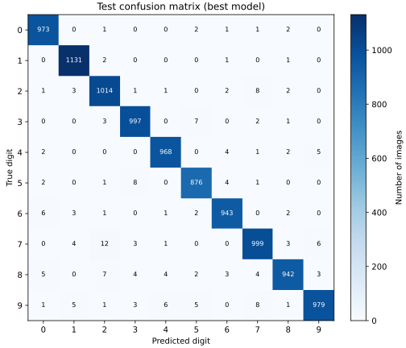

# 从图片到预测：把 CNN 的整个训练过程讲通

本教程先理解一条完整的数据路径，再学习调参。主 README 负责安装和命令；这里解释代码为什么这样写。默认网络很小，重点是理解训练过程，而不是追求 MNIST 排行榜成绩。

## 运行环境

首次安装见 [README](../README.md#安装)。本文使用 Miniconda 的 `cv_study` 环境，Python 版本为 3.11.x。每次打开终端后，先进入项目目录，再执行：

```bash
conda activate cv_study
python --version
python -c "import sys; print(sys.executable)"
```

`python` 应指向 `cv_study` 环境中的解释器。Miniconda 的 base 环境可以使用其他 Python 版本，不影响这个项目环境。项目依赖通过激活后的 `python -m pip install -r requirements.txt` 安装。

## 1. 我们在解决什么问题

MNIST 中每张图片是一个手写数字：28 像素高、28 像素宽、一个灰度通道。输入是图片，输出是 0～9 中的一个类别，这叫十分类。

一张图片可以理解成 28 行、28 列的数字表格。像素描述亮度；标签是正确答案，例如整数 `7`。网络看到的是数字数组，不是人眼看到的“7”这个概念。

学习前先运行 `python train.py`，观察程序打印的图片形状、标签示例、模型结构、逐轮指标和输出目录；暂时不用修改参数。

## 2. 训练集、验证集、测试集和标签

默认划分如下：

| 数据 | 数量 | 何时使用 | 标签做什么 | 更新模型参数吗 |
|---|---:|---|---|---|
| 训练集 | 50,000 | 每个训练批次 | 计算损失，指导反向传播 | 会 |
| 验证集 | 10,000 | 每轮训练结束 | 给当前模型评分，帮助调参、选 best、早停 | 不会 |
| 测试集 | 10,000 | 设置确定、训练结束后 | 给最终模型评分 | 不会 |

官方训练集有 60,000 张，`data.py` 从中划出验证集；官方 10,000 张测试图独立保留。修改 `VALIDATION_SIZE` 会改变前两份数量，不改变测试集。

标签相当于标准答案。图片输入模型得到预测后，再拿预测和标签比较。比如真实标签为 7，预测为 7 就答对，否则答错；正确类别 7 得到的预测概率越低，交叉熵损失越大。

**标签不会作为提示答案输入网络。** 没有标签也能预测，但不能计算准确率。验证和测试即使计算了损失，也没有执行反向传播和参数更新。

验证集会间接影响模型：我们用它选择设置，回调用它调整学习率、选择 best 和决定何时停止。测试集应留到最后；如果反复根据测试分数改参数，它也参与了选择，最终评估就不再独立。

在自己的数据中，同一原图的裁剪、同一人的照片或同一视频的相邻帧，可能不能随机分到训练和验证两边。先按来源划分，再处理数据，避免内容泄漏。MNIST 教程直接使用官方划分。

## 3. 预处理为什么只有两步

`preprocess_images` 先将像素转成 `float32`，再除以 255，把范围从 0～255 缩放为 0～1；然后增加灰度通道维度。

```text
原始图片：(N, 28, 28)
处理以后：(N, 28, 28, 1)
```

`N` 是图片数量。一批 64 张图片就是 `(64, 28, 28, 1)`。这不是把 64 张图拼成一张，而是将它们打包交给同一个模型。

这里没有用数据均值、方差归一化，所以不需要估计统计量。如果以后改用均值/方差，应该只从训练集估计，再用于验证、测试和预测。

训练与预测必须使用相同的预处理。原始像素忘记除以 255、黑白背景颠倒、图片未居中，都可能导致“训练很好，自己的图片却识别不好”。手机照片还需要裁剪、缩放、背景处理，不能直接当成 MNIST。

## 4. 网络的每一层在做什么

`model.py` 使用 Keras 基础层按顺序组合网络。自动求导交给框架；我们自己决定数据怎样经过各层。

| 层 | 默认输出形状（省略批次维） | 作用 | 可训练参数 |
|---|---|---|---:|
| Input | `28×28×1` | 接收灰度图 | 0 |
| Conv2D + ReLU | `26×26×8` | 提取局部笔画特征 | 80 |
| MaxPooling2D | `13×13×8` | 压缩空间尺寸 | 0 |
| Flatten | `1352` | 把特征排成向量 | 0 |
| Dropout | `1352` | 训练时随机丢弃部分特征 | 0 |
| Dense + softmax | `10` | 综合特征，输出十类概率 | 13,530 |

总计 **13,610 个可训练参数**。`summary()` 中的 `None` 表示批次大小尚未固定。

### 卷积：在局部寻找规律

一个 3×3 卷积核在图上滑动，对每个覆盖区域做加权计算。卷积核权重会被学习，不是人工写死的“横线模板”。默认 8 个卷积核产生 8 张特征图。

不补边、步长为 1 时，宽高从 28 变为 `28 - 3 + 1 = 26`。每个卷积核有 `3×3×1` 个权重和一个偏置，因此参数为 `(3×3×1 + 1)×8 = 80`。

ReLU 是 `max(0, x)`，将负值变为零，加入非线性；没有非线性的层叠加，表达能力会受到限制。

### 池化与展平：改变特征表示

最大池化默认每个 2×2 区域取最大值，空间尺寸从 26 缩到 13。池化和展平都不学习参数。

展平得到 `13×13×8 = 1352` 个数。最后的全连接层输出十个分数，参数为 `(1352 + 1)×10 = 13530`；softmax 再把分数转成总和为 1 的概率。

概率最大的下标是预测数字。预测概率很高仍可能出错，它不是正确性的保证。

### 改结构时看什么

增加 `CONV_FILTERS` 通常会增加容量和计算量，也会增加展平后全连接层的参数。修改 `KERNEL_SIZE` 会影响输出尺寸，不能只改数字而不看 `model.summary()`。

可以在理解现有网络后，手动增加第二个卷积和池化模块，再重新计算尺寸。先解释每一层为什么需要，再考虑更深的网络。

## 5. Dropout 和 L2：限制模型过分记住训练集

`DROPOUT_RATE=0.2` 表示训练时随机将部分特征置零，减少模型对个别特征的依赖。Keras 会缩放保留的特征，验证和预测时自动关闭 Dropout。它没有可训练参数。

`L2_FACTOR=0.0001` 在输出层权重上加入 L2 惩罚，抑制过大的权重。因此本项目显示的总损失是：

```text
总损失 = 分类交叉熵 + L2 系数 × 输出层权重平方和
```

交叉熵使用正确类别的概率，单张图片可理解为 `-log(正确类别的概率)`；正确类别概率接近 1 时损失较小，接近 0 时损失较大。

L2 太强、Dropout 太大，都可能导致学不充分。设 `L2_FACTOR=0` 或 `DROPOUT_RATE=0` 可以分别关闭，观察验证结果。L2 不是学习率，也不是 Adam 中的学习规则。

## 6. compile：设置学习规则，还没有开始学习

```python
model.compile(
    optimizer=keras.optimizers.Adam(learning_rate=config.LEARNING_RATE, clipnorm=config.CLIPNORM),
    loss="sparse_categorical_crossentropy",
    metrics=["accuracy"],
)
```

- `optimizer` 决定怎样根据梯度更新权重和偏置。这里用 Adam，初学时先理解学习率。
- `loss` 是优化目标。`sparse` 表示标签直接使用整数 0～9，不需要转换成长度为 10 的独热向量。
- 输出已经经过 softmax，因此交叉熵按概率计算，不能同时设置 `from_logits=True`。
- `metrics` 用于观察。准确率只看有没有答对，不直接表达“正确类别概率有多大”，也不是本项目反向传播使用的目标。

`CLIPNORM=1.0` 限制梯度范数；Keras 的这个参数逐个裁剪各权重张量的梯度。它能缓解异常大的更新，但不能修复错误标签、坏数据或不合理的学习率。设为 `None` 可关闭。

## 7. fit：一轮里面发生了什么

每个批次重复四步：

1. 前向传播：输入图片，计算十类概率。
2. 计算损失：用标签计算交叉熵，加上 L2 正则项。
3. 反向传播：计算损失对各个可训练参数的梯度。
4. 优化器更新：Adam 根据梯度调整参数，尝试减小损失。

Keras 负责自动求导，不需要手写卷积反向传播。损失可能局部波动，不要求每个批次都严格降低。

`BATCH_SIZE=64`，50,000 张训练图一轮有 `ceil(50000 / 64) = 782` 批。最后一批不足 64 张也会参与训练。一轮叫 epoch，一次批次更新叫 step；50 轮不等于更新 50 次。

`shuffle=True` 每轮打乱训练样本的读取顺序。验证集仍是同一份，便于比较。验证过程中 Dropout 关闭，也不更新参数。

## 8. best 和 last 为什么都要保存

| 文件 | 保存时机 | 主要用途 |
|---|---|---|
| best.keras | 本轮验证损失比之前所有轮次更低时 | 默认推理和最终测试 |
| last.keras | 每个完整训练轮次结束时 | 保留训练终点，检查训练过程或作为继续训练起点 |

例如验证损失依次为 `0.6、0.2、0.4`，第 2 轮最好，因此 best 保存第 2 轮，last 保存第 3 轮。**best 的标准是 val_loss 最低，不是 val_accuracy 最高，更不是测试分数最高。**

两个文件保存的是完整模型，包括结构、参数、优化器状态。保存完整模型便于加载，不代表有两个不同的网络设计。若最后一轮正好最好，两个文件参数相同完全正常。

回调设置 `save_best_only=True` 时只更新 best；last 每轮覆盖，但只覆盖本次实验目录的 last。新实验使用新目录，因此旧结果仍在。

如果程序在一个批次中断，last 只代表上一个完整结束并成功保存的轮次，不是中断前最后一批。它不是逐批故障恢复系统。

## 9. 学习率调度和早停怎样配合

### 学习率调度

初始学习率是 `0.001`。启用 `ReduceLROnPlateau` 后，验证损失连续 `LR_PATIENCE=3` 轮没有下降，就乘以 `LR_FACTOR=0.5`，最低到 `MIN_LEARNING_RATE=0.00001`。

例如 `0.001 → 0.0005 → 0.00025`。降低学习率让后续更新更小，但不保证验证结果一定改善。`USE_LR_SCHEDULER=False` 可以关闭，便于比较固定学习率。

### 早停

验证损失连续 `EARLY_STOPPING_PATIENCE=8` 轮没有下降，就结束训练。`EPOCHS=50` 因而是上限。早停的耐心通常应大于调度的耐心，给降低学习率后继续学习留出时间。

本项目设置 `restore_best_weights=False`，训练内存状态保持在最后轮次；最终测试时明确重新加载 best。这样 best 和 last 的含义清楚，不会在结束时把 last 也变回 best。

### 回调顺序

每轮结束的顺序是：记录本轮学习率 → 必要时降低下一轮学习率 → 保存 best/last → 写 CSV → 判断早停。

因此 CSV 的 `learning_rate` 记录本轮实际使用的值；这一轮保存的优化器则已经包含为下一轮调整后的学习率。CSV 的 `epoch` 从 0 开始，图和 `metrics.json` 中的轮次从 1 开始。

`TerminateOnNaN` 遇到非有限训练损失会要求停止；训练结束后还会检查指标。出现 NaN/Inf 时不会生成正常完成标记，应查看日志排查。

## 10. 为什么要保留配置、CSV 和实验目录

固定 `SEED=42` 会设置 Python、NumPy 和 TensorFlow 的随机种子，方便同一环境下比较；跨硬件、版本仍可能有差异。不要通过反复换种子挑一个最好看的测试分数。

每次运行生成独立目录，`config.json` 保存这次的设置及实际 Python/依赖版本。以后即使修改 `config.py`，仍能知道旧模型用的是什么参数。`history.csv` 保存逐轮指标，不必只依赖终端滚动输出。

`metrics.json` 最后写入，标记本次流程完整完成。默认预测通过它找到最近一次完成的实验，避免自动选中还没结束的训练。通过 `--run-dir` 可以明确指定其他实验。

## 11. 怎样读曲线和错误图片

`curves.png` 包含损失、准确率、学习率三个面板。训练/验证使用不同颜色和线型；竖线标记验证损失最低的轮次。它描述的是一次训练的轨迹，没有多次独立实验，因此没有误差带或显著性结论。

| 现象 | 可能原因 | 优先检查或尝试 |
|---|---|---|
| 训练、验证都差 | 欠拟合、训练不足、输入或标签有问题 | 先检查数据和损失，再考虑轮数、学习率和容量 |
| 训练越来越好，验证变差 | 过拟合或训练/验证分布不同 | 查看样本、best/last 差异，比较正则化和早停 |
| 损失剧烈波动或 NaN | 学习率太大、输入异常、梯度异常 | 检查有限数值和归一化，降低学习率，观察梯度裁剪 |
| 验证准确率高于训练 | Dropout、训练时参数仍不断更新等 | 先理解两种模式和统计时机，不直接认定数据泄漏 |
| 自己拍的图片效果差 | 背景、居中、尺寸或数据分布差异 | 检查预处理，收集符合使用场景的数据 |
| 内存不足 | 批次太大，数据或模型太大 | 减小批次；本教程用小模型和 float32 |

这些是排查方向，不是单靠一条曲线就能确定的原因。

混淆矩阵的行是真实类别，列是预测类别。对角线上的数字表示识别正确，其他格子帮助发现经常混淆的类别。下面是本项目一次完整训练的实际结果，不是所有实验的通用结论。



`mistakes.png` 展示按测试集顺序遇到的前 10 张错误图片，不代表全部错误的分布。先核对标签是否合理、笔画是否模糊，再决定下一项实验。测试失败样本可用于解释最终结果；若据此继续改模型，原测试集就已参与开发，应另留独立评估数据。

## 12. evaluate 与 predict 在什么时候使用

`evaluate(图片, 标签)` 内部会做预测，再计算损失和准确率。`predict(图片)` 只返回预测概率，不需要标签，也不会更新参数。

本项目训练结束后，只对验证集选出的 best 做完整测试；last 不参与最终模型选择。`predict.py` 可以分别加载 best 或 last，对照观察前 10 张图片：

```bash
python predict.py --checkpoint best
python predict.py --checkpoint last
```

预测页面中的“真实数字”来自测试标签，只用于显示对照。前 10 张的正确个数不等于全测试集准确率，预测概率也不保证正确。

## 13. 做几组能解释原因的实验

每次只改一个因素，使用验证集比较，保留对应目录。下面的候选值用于学习，不是经过搜索的最佳参数。

| 实验 | 只改哪里 | 候选设置 | 重点观察 |
|---|---|---|---|
| 训练时长 | EPOCHS | 3、10、50 | 验证损失何时不再下降 |
| 初始步幅 | LEARNING_RATE | 0.001、0.0003 | 收敛速度和验证损失 |
| 批次大小 | BATCH_SIZE | 32、64、128 | 每轮步数、时间、验证效果 |
| 表达容量 | CONV_FILTERS | 8、16 | 参数量、欠拟合和过拟合 |
| 卷积窗口 | KERNEL_SIZE | 3、5 | 输出尺寸和局部特征范围 |
| 随机正则化 | DROPOUT_RATE | 0、0.2、0.4 | 训练/验证差距 |
| 权重约束 | L2_FACTOR | 0、0.0001、0.001 | 总损失组成和泛化 |
| 自动降学习率 | USE_LR_SCHEDULER | True、False | 学习率曲线和验证结果 |
| 自动停训 | USE_EARLY_STOPPING | True、False | best/last 的轮次差异 |

学习比较固定轮数时，可先关闭早停，避免较大的 EPOCHS 最终都在同一轮停止；其他设置保持一致。正式比较应重复不同种子的独立实验，报告波动，不能用一次结果断言方法一定更好。

记录可以使用下面的表格：

| 现象 | 假设 | 单项改动 | 验证指标与失败样本 | 结论及边界 |
|---|---|---|---|---|
| 自己填写 | 自己填写 | 自己填写 | 自己填写 | 自己填写 |

## 14. 保存模型不等于精确恢复整个训练进度

加载 `.keras` 会恢复结构、参数和优化器状态。已经编译的模型可以继续 `fit`；重新 `compile` 一个新优化器通常会重置优化器状态。

但学习率调度、早停回调的耐心计数、完整数据顺序和训练轮次等控制状态，不会只靠 `load_model` 自动精确恢复。`initial_epoch` 只是告诉 fit 从哪个轮次计数，不会自行恢复所有控制状态。

本教程保留 last 作为检查和继续学习的起点，暂未实现完整断点续训。理解这些边界以后，再学习更完整的恢复方案。

## 15. 学完以后可以继续研究什么

先能讲清“输入和标签 → 网络 → 损失 → 梯度 → 更新 → 验证选模型 → 测试 → 推理”，再逐步研究数据增强、BatchNorm、更深网络、类别不平衡、混合精度或多设备训练。

数据增强必须合理保留类别含义，而且只对训练数据随机应用。类别不平衡时只看整体准确率可能掩盖少数类别问题，可以进一步计算每类 precision/recall。加入新机制时记录它解决的具体问题，不要一次堆叠所有技术。

## 16. 核心检查清单

- 是否已激活 `cv_study` Conda 环境，Python 是否为 3.11.x，实际安装依赖版本是否记录？
- 图片和标签是否对应，形状、通道、数值范围是否正确？
- 训练/验证/测试是否独立，预测预处理是否一致？
- 输出是否为十类概率，损失函数是否匹配整数标签与 softmax？
- loss 是否包含正则化，优化器和学习率是否明确？
- batch、step、epoch 的数量是否理解，随机种子与 shuffle 是否明确？
- best 是否只看验证集，last 是否仍保存训练终点？
- 早停、降学习率与 CSV 记录的时机是否理解？
- 是否看了验证曲线、混淆矩阵和错分样本，而不仅是一个准确率？
- 是否区分一次实测、控制变量实验和经过重复验证的结论？
